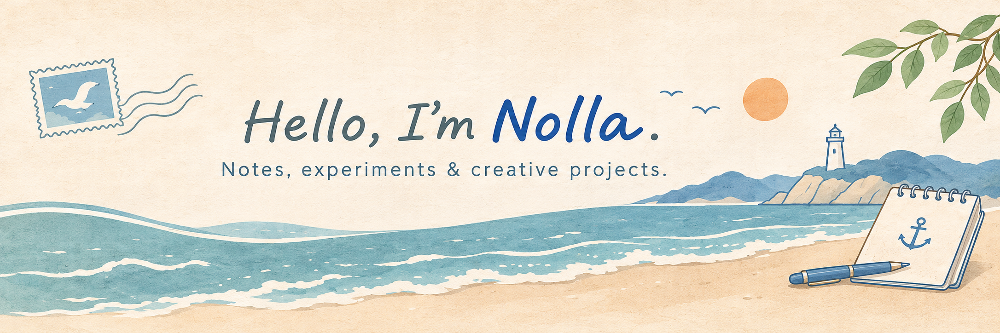
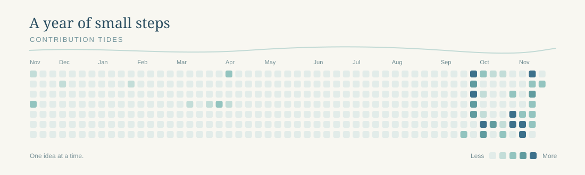

### 🌿 About

A personal space for notes, experiments, and creative projects. I enjoy exploring new tools and learning by building.

### ✧ Interests

  

### ◇ Selected Projects

- **[PKU_boyaTower](https://github.com/R3dra1n/PKU_boyaTower)** — A 3D model of Peking University's Boya Tower.
- **[python](https://github.com/R3dra1n/python)** — Python side projects and experiments.

### 🌊 Contribution Tides

Real GitHub contributions · Updated daily
