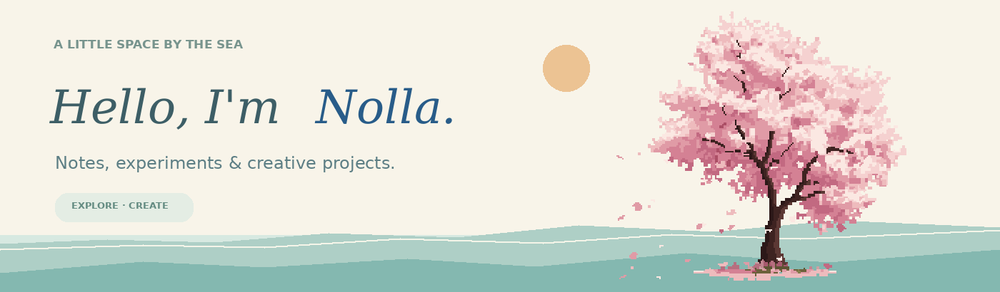
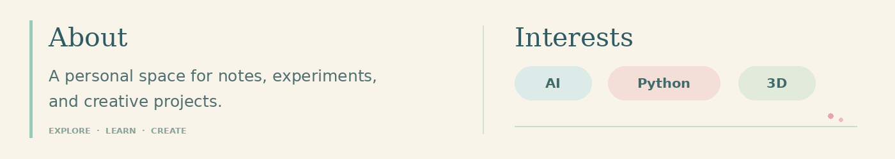
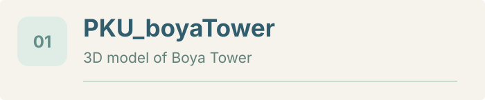
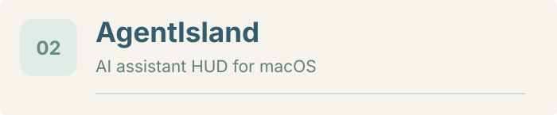

<picture><source media="(max-width: 600px)" srcset="assets/banner-mobile-adaptive.svg"><source media="(prefers-color-scheme: dark)" srcset="assets/coastal-tree-breeze-dark.gif"></picture>

<picture><source media="(max-width: 600px)" srcset="assets/about-mobile-adaptive.svg"><source media="(prefers-color-scheme: dark)" srcset="assets/about-panel-dark.png"></picture>

### ◇ Selected Projects

<a href="https://github.com/R3dra1n/PKU_boyaTower"><picture><source media="(max-width: 600px)" srcset="assets/project-boya-sharp-mobile.svg"><source media="(prefers-color-scheme: dark)" srcset="assets/project-boya-sharp-dark.svg"></picture></a> <a href="https://github.com/R3dra1n/AgentIsland"><picture><source media="(max-width: 600px)" srcset="assets/project-agent-sharp-mobile.svg"><source media="(prefers-color-scheme: dark)" srcset="assets/project-agent-sharp-dark.svg"></picture></a>

### ✿ Contribution Tides

<picture><source media="(max-width: 600px)" srcset="assets/contributions-mobile-adaptive.svg"><source media="(prefers-color-scheme: dark)" srcset="assets/contributions-snake-dark.svg"></picture>

Real GitHub contributions · Updated daily · A little snake that grows and starts again
